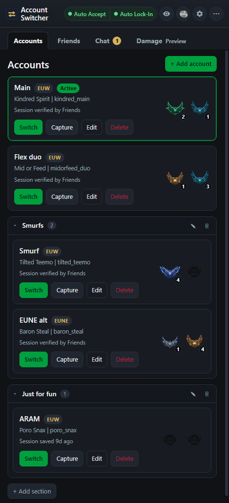
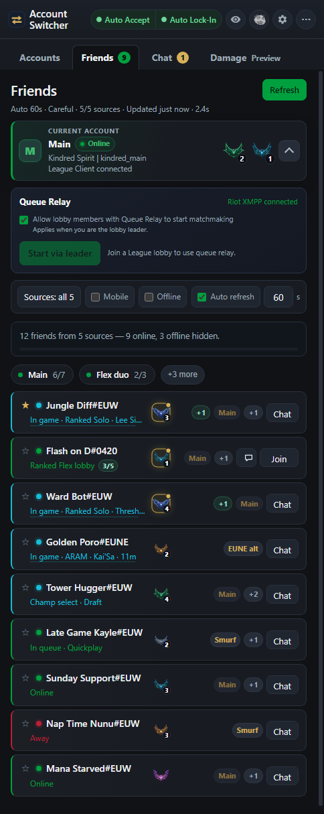
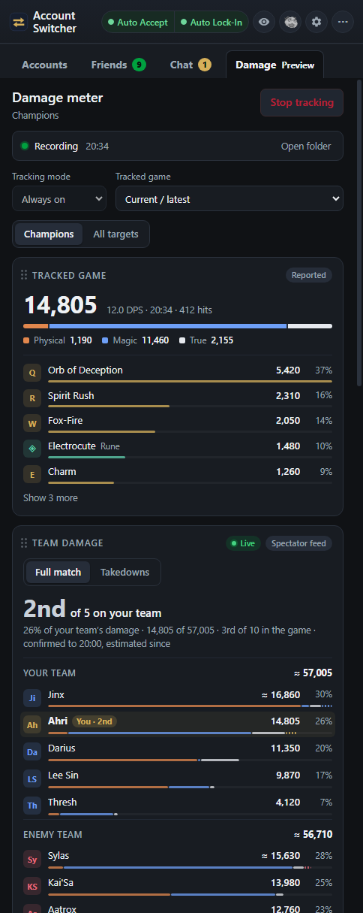
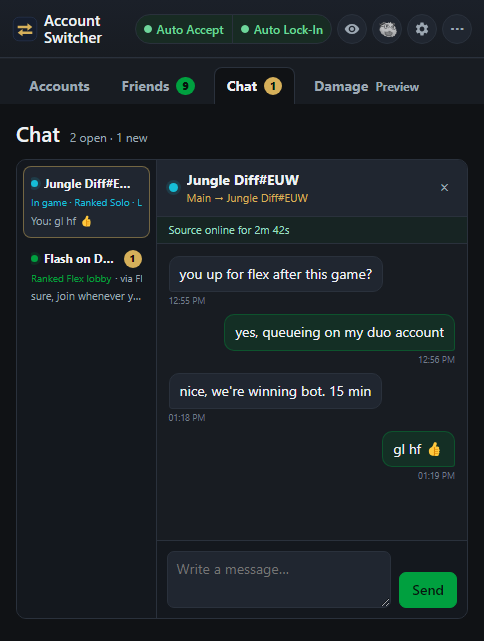
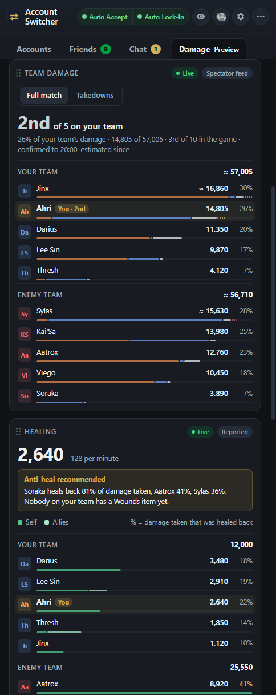
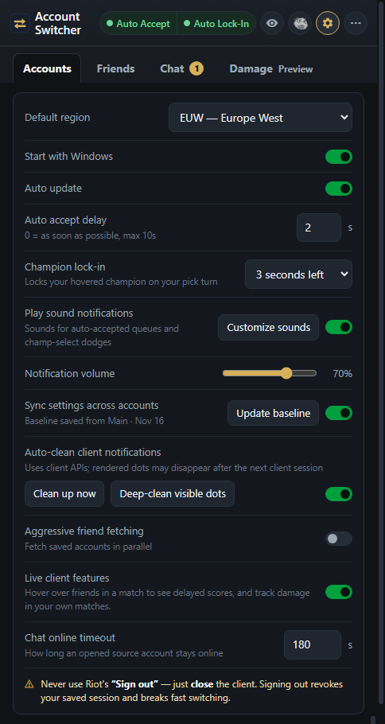

# League Account Switcher

A Windows app for switching between your League of Legends accounts in one click. It sits in the
system tray, signs you in without typing a password, and adds a few quality-of-life tools for queue,
champion select, friends and chat.

<table>
  <tr>
    <td valign="top"></td>
    <td valign="top"></td>
    <td valign="top"></td>
  </tr>
</table>

## Install

1. Download the latest `league-account-switcher-<version>-x64.exe` from
   [Releases](https://github.com/Jonas-Merforth/league-account-switcher/releases/latest).
2. Run the installer. The app starts in the tray and opens its window.

The app updates itself. It checks for a new version on launch and every 10 minutes.

Requires Windows 10 or 11 with the Riot Client and League of Legends installed.

## Getting started

1. Click **+ Add account** and enter a label (for example "Main"), your Riot username and region.
   A password is optional.
2. Sign in to that account in the Riot Client with **Stay signed in** checked.
3. Click **Capture** on the account card. The app closes the Riot Client and saves the session.
4. Repeat for your other accounts.

From then on, click **Switch** on a card, or right-click the tray icon and pick an account. The app
closes the Riot Client, restores that account's saved session and starts it again, already signed in.

> **Never use Riot's "Sign out" button.** Just close the client. Signing out cancels the saved
> session on Riot's side, so the next switch can't sign you in. If it happens, sign in again and
> click **Capture**.

Saved sessions last about 1 to 3 weeks. When a card says the session may be expired, sign in again
and click **Capture**. If you saved a password, switching still works in the meantime: the app types
the login for you instead.

## Features

### Switching

- Switch from the window or from the tray menu.
- Drag cards to reorder them, and group them into collapsible sections. The tray menu uses the same
  order.
- If you are in champion select or a game, the app asks before closing it. **Force switch** closes
  it anyway.
- **Porofessor** and **OP.GG** buttons open the signed-in account's live game or profile.
- **Stats** (in the **...** menu) shows logins and games per account and queue.

### Queue and champion select

- **Auto Accept** accepts every ready check after a delay you choose (0 to 10 seconds, default 2).
  Green means on.
- **Auto Lock-In** locks the champion you are hovering at the end of your pick turn. In Settings you
  can lock with 3, 5 or 10 seconds left, or instantly. If nothing is hovered, the pick stays open.
- **Sound notifications** play when a queue is accepted or someone dodges. You can pick your own
  sound files and set the volume.
- **Appear Offline** (eye icon) sets League chat to offline. Turn it on while signed in to go
  offline right away, or with no client open so the next account you switch to logs in offline.
  Switching again turns it off. A slashed gold eye means you appear offline.

### Friends

The **Friends** tab merges the friend lists of several of your accounts, so you can see who is online
across all of them at once. It reads each account's saved session in the background, without
switching or closing your client.

- **Sources** picks which accounts to include.
- **Mobile** and **Offline** show friends who are only on the Riot mobile app, or offline.
- **Auto refresh** keeps the list up to date on a timer.
- Each friend shows what they are doing (in game, in a lobby, in queue), their rank, and which of
  your accounts they are friends with. Click an account pill to switch to it.
- **Join** joins a friend's open lobby, and **Invite** invites them to yours.
- Star a friend to keep them at the top.
- With **Live client features** on, hover a friend who is in a match to see their score from Riot's
  delayed spectator feed.

If an account shows as **failed**, its saved session can't be reused. Click **Fix failed sessions**
and the app signs in to each one again and saves a fresh session. It types the logins one by one, so
don't use the mouse or keyboard while it runs.

### Chat

Click **Chat** on a friend, or right-click them, and pick which of your accounts to chat from. Each
conversation keeps that route (your account, then the friend), so chats with the same person from
different accounts stay separate.

The chosen account comes online while you chat and goes offline again after the **Chat online
timeout** (3 minutes by default). Unread messages show as a number on the Chat tab. Drafts and the
last 200 messages per chat are saved on your PC.



### Queue Relay

If you are in a lobby and the leader also uses Account Switcher, **Start via leader** (Friends tab)
starts matchmaking for the whole lobby without waiting for them. Leaders can turn this off with the
**Allow lobby members with Queue Relay to start matchmaking** switch.

### Damage Preview

The **Damage** tab tracks your damage while you play:

- Your total damage, split into physical, magic and true, with a list of what dealt it (abilities,
  items, runes, summoner spells).
- **Team damage**: how you compare with every teammate and enemy, and your place on the team.
- **Healing**: how much each champion heals, with a hint to buy anti-heal when the enemy out-heals
  your team.
- **Latest fight**, **Damage taken** and **Damage dealt** per enemy champion.
- Past games are saved and can be reopened from **Tracked game**.

Click **Start tracking** before a match. **Always on** tracks every match until you stop it,
**Next game** tracks just one. Windows asks for administrator permission when tracking starts. The
tab and the friend score previews can be turned off with **Live client features** in Settings.



### Shared settings

League saves keybinds, camera and video/audio settings per account. Turn on **Sync settings across
accounts** and the app keeps them the same on every account. Set things up how you like, turn the
option on, and from then on changes are saved after each game and carried over on every switch.
**Update baseline** saves your current settings right away. Rune pages and item sets stay separate
per account.

### Notification cleanup

**Auto-clean client notifications** claims Season and Mayhem pass rewards and clears the red dots on
League home, Collection, TFT, profile and the notification bell. It works in the background and
pauses during champion select and games. Some dots that are already showing only disappear after
the next League restart. **Deep-clean visible dots** clears those right away while League is idle.
**Clean up now** runs a single cleanup without turning on the automatic one.

### App

- Closing the window keeps the app in the tray. Use **Quit** in the tray menu to exit.
- **Start with Windows** starts it in the tray when you sign in to Windows.
- **Auto update** installs new versions on its own. With it off, a banner offers the update.
- **Help** (in the **...** menu or the tray) opens the built-in guide.



## Privacy

Passwords, saved sessions and chat history are encrypted with Windows' built-in protection (DPAPI).
Only your Windows user on this PC can read them, and nothing is uploaded. The app only talks to Riot's
services and to the Riot Client and League client running on your PC.

Accounts are stored in `%AppData%\LeagueClientAutomation`. The League Client Automation app uses
the same folder, so accounts added in one show up in the other. Don't switch in both apps at the same time.

## Troubleshooting

| Problem | What to do |
| --- | --- |
| The app started typing my login | That's the password fallback, used when the saved session is missing or expired. Click **Capture** after it signs in to save a fresh session. |
| A captcha appeared | Solve it in the Riot Client. The switch continues once you are signed in. |
| Stuck on the Riot sign-in screen | The saved session was rejected, usually after using "Sign out". Sign in yourself, then click **Capture**. |
| "Switching would close it" | You are in champion select or a game. Finish first, or use **Force switch**. |
| An account shows as failed in Friends | Click **Fix failed sessions**. |
| Something else | Right-click the tray icon, choose **Open logs**, and send `switcher.log` along with your report. |

## Development

Requires Node.js 20 or newer.

```powershell
npm install
npm start       # run the app
npm test        # run the unit tests
```

If `npm start` says "Electron failed to install correctly", run `npm run fix-electron` and try
again. On some Windows setups npm skips or breaks Electron's own install step. Run it again after
every fresh `npm install`.

These environment variables point the app at test files instead of your real install:
`LCA_CONFIG_DIR`, `LCA_RIOT_SESSION_FILE`, `LCA_RIOT_LOCKFILE`, `LCA_RIOT_CLIENT_EXE`,
`LCA_LEAGUE_PATH`. The League install folder is found automatically; set `LCA_LEAGUE_PATH` if that
fails.

The app writes a log to `%AppData%\LeagueClientAutomation\switcher.log` and keeps the last 3 days.

To record League client events while investigating behavior:

```powershell
node scripts/debug-lcu-events.mjs "$env:TEMP\league-lcu-events.jsonl"
```

The output never contains the client password, but it can contain account and notification details.

### Building

```powershell
npm run dist    # build the installer into dist/
npm run pack    # unpacked build, faster for quick checks
```

If `npm run dist` fails with "Cannot create symbolic link", run it from an administrator PowerShell
or turn on Windows Developer Mode. The unpacked app in `dist\win-unpacked` is still usable.

Icons are generated from code: `node build/generate-icons.mjs`.

### Releasing

Updates are served from this repository's GitHub Releases, so the repository must stay public.

```powershell
npm version patch
$env:GH_TOKEN = "<GitHub token with repo scope>"
npm run release
```

This builds the installer, `latest.yml` and the `.blockmap` and publishes a release right away.
Installed copies pick it up within 10 minutes. Auto-update only runs in the installed app, not in
`npm start`.

### Project layout

```
src/
  core/       switching engine, Riot and League client integration
  main/       Electron main process: window, tray, IPC, updater
  preload/    bridge between main process and window
  renderer/   the app window (HTML, CSS, JS)
  help/       the built-in help guide
  assets/     generated icons
build/        icon generator and packaging hooks
docs/         research notes and screenshots
test/         unit tests
```

Research notes for individual features live in [`docs/`](docs/).
